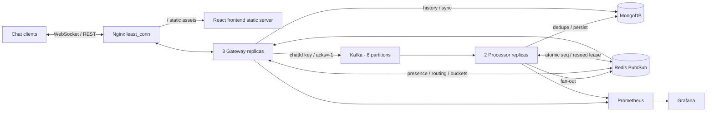
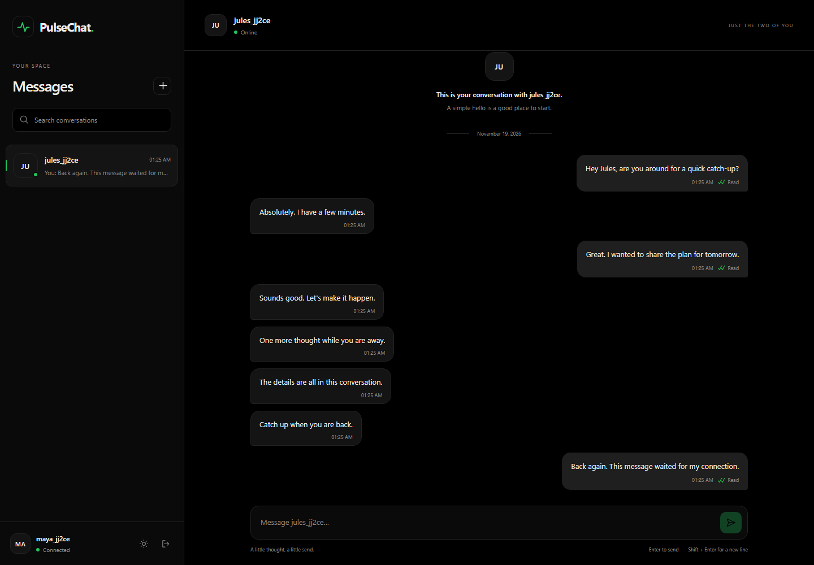

# PulseChat

[](https://github.com/ShlokMaharwal/PulseChat/actions/workflows/ci.yml)

A real-time chat application with an independent React 18 frontend and a distributed TypeScript backend built with WebSockets, Kafka, Redis, and MongoDB. Three gateways and two processors handle live delivery, ordered persistence, and recovery after failures.

The interface includes login, registration, conversations, unread badges, presence, delivery/read receipts, and persistent light and dark themes. Both applications have their own dependencies, types, tests, and builds. Verification evidence includes real browser sessions, replicated integration tests, fault injection, and measured load results.



## Quick start

Use Docker Desktop with Linux containers and Docker Compose v2. Run the following commands from the repository root. Host checks need Node.js 20+ for the backend and Node.js 22.13+ for the frontend tooling, plus npm. Containers use Node.js 22.

```sh
docker compose --parallel 1 up --build -d --wait --wait-timeout 600
docker compose run --rm --no-deps smoke
```

`docker compose up --build` also starts the stack in the foreground. Backend replicas create/verify the required topics and indexes on startup. Kafka uses KRaft and one broker, and Redis has AOF persistence. Lightweight container TCP probes are supplemented by actual dependency commands in backend readiness and smoke checks.

To resume an existing build:

```sh
docker compose --parallel 1 up -d --wait --wait-timeout 600
```

To stop the stack:

```sh
docker compose stop
```

Named volumes preserve accounts, message history, and receipts between stops.

| URL                                                             | Purpose                          |
| --------------------------------------------------------------- | -------------------------------- |
| [localhost:8080](http://localhost:8080)                         | Chat application                 |
| `http://localhost:8080/api/auth/register`                       | Registration endpoint            |
| `http://localhost:8080/ws`                                      | Authenticated WebSocket upgrade  |
| `http://localhost:8080/healthz`                                 | Nginx liveness                   |
| `http://localhost:8080/readyz`                                  | Proxied gateway readiness        |
| [localhost:9090](http://localhost:9090)                         | Prometheus                       |
| [Grafana dashboard](http://localhost:3000/d/pulsechat-overview) | Provisioned operations dashboard |

## Try the demo

1. Open [localhost:8080](http://localhost:8080) in two separate browser profiles, or use a normal window and a private window.
2. Register a different account in each session. On the first account, choose **New conversation**, search for the other username, and start a conversation.
3. Send a message, then open the conversation in the other session. Check the unread badge, online presence, and sent/delivered/read status as both accounts exchange messages.
4. Toggle between light and dark themes, then reload to check that the selected theme and conversation history return.
5. For offline recovery, take one browser offline through its developer tools. Send messages from the other account and queue a message in the offline browser, then restore its connection. Both views recover the ordered conversation.

The [browser verification record](docs/phase-6-browser.json) also covers killing the connected gateway, reconnecting through another replica, replaying missed messages, and retaining the queued send's original ID. Automated failure checks are described under [Tests and proof](#tests-and-proof).

## Development

Grafana local defaults are `admin` / `pulsechat-local`. Copy `.env.example` to `.env` to change the development JWT secret or Grafana password. Changing the password environment variable does not reset Grafana's already-persisted admin account. All published ports bind to loopback; the unauthenticated local Kafka, MongoDB, and Redis listeners and the single-node data services are development defaults.

For backend-only containers, omit the reverse proxy and monitoring UI:

```sh
docker compose --parallel 1 up --build -d --wait kafka redis mongo gateway-1 gateway-2 gateway-3 processor-1 processor-2
```

The integration runner reaches those gateways directly on the Compose network. For host development, start `kafka redis mongo`, set a JWT secret of at least 32 characters, then run `npm ci` and `npm run dev:gateway` or `npm run dev:processor` in `backend/`. Host defaults use Kafka `19092`, Redis `16379`, and MongoDB `27018`. The gateway's direct REST paths omit `/api`.

For frontend development, keep the Compose stack running, then:

```sh
cd frontend
npm ci
npm run dev
```

Open `http://127.0.0.1:5173`. Vite proxies REST and WebSocket requests to the running stack at port 8080. Direct-gateway proxy settings and browser storage behavior are documented in [frontend/README.md](frontend/README.md).



The dark theme uses true black and neutral gray surfaces, with emerald accents. Themes follow the system preference until a saved toggle choice overrides it. See the [light theme](docs/img/chat-light.png) and [mobile view](docs/img/chat-mobile.png).

## Behavior and guarantees

- Bcrypt password hashing and expiring HS256 JWTs; membership checks for sends, history, receipts, and presence.
- Kafka acceptance ACK followed by a persisted `sent` ACK; stable sender-scoped UUIDs and unique indexes dedupe retries.
- Atomic Redis sequence assignment with idempotent message mappings and a lease-guarded MongoDB reseed when counters disappear.
- Ordered, paginated sync and periodic tail recovery; reconnect with exponential backoff/jitter and reuse of unacked IDs.
- Persisted cumulative delivered/read cursors, unread counts, TTL presence, and concurrent sessions across gateways.
- Arrival-time per-user token buckets, bounded frame size, bounded queues/output, and graceful service shutdown.
- Manual Kafka offsets and dependency-aware retries that retain records during infrastructure outages; bounded poison-record retries and durable DLQ envelopes.
- Structured correlation logs, Prometheus metrics, and a provisioned Grafana dashboard.

Storage is effectively once under the tested crash/retry model. Pub/Sub is best effort, and sync is required for recovery. A terminal DLQ record is a visible delivery failure. This local single-broker/single-database stack does not provide infrastructure high availability. See [the protocol](docs/PROTOCOL.md) and [design and failure boundaries](docs/DESIGN.md).

## Tests and proof

The implementation at `199d616` passed both application jobs in [GitHub Actions](https://github.com/ShlokMaharwal/PulseChat/actions/runs/44386776771). The recorded local verification was completed on 19 November 2026:

| Check                        | Result                                                                         | Evidence                                                 |
| ---------------------------- | ------------------------------------------------------------------------------ | -------------------------------------------------------- |
| Backend unit tests           | 63 passed                                                                      | [Final verification](docs/phase-6-verification.md)       |
| Frontend SDK unit tests      | 9 passed                                                                       | [SDK tests](frontend/tests/client.test.ts)               |
| Replicated integration tests | 10 passed, including 1,000 ordered cross-gateway messages                      | [Final verification](docs/phase-6-verification.md)       |
| Smoke checks                 | 11 passed                                                                      | [Final verification](docs/phase-6-verification.md)       |
| Chaos scenarios              | Four passed across 485 logical sends                                           | [Final chaos results](docs/final-chaos-results/)         |
| Real browser sessions        | Chat, themes, receipts, presence, offline queuing, and gateway recovery passed | [Browser proof](docs/phase-6-browser.json)               |
| Vite development proxy       | Login, history, and WebSocket welcome passed                                   | [Development proxy proof](docs/phase-6-dev-browser.json) |

Run the source checks, integration tests, chaos scenarios, and load profiles:

```sh
cd backend
npm ci
npm run lint
npm run format:check
npm run typecheck
npm test
npm run build
cd ..
docker compose --parallel 1 build integration
docker compose --profile test run --rm --no-deps integration
cd backend
npm run test:presence
npm run test:chaos
npm run test:load -- 200
npm run test:load -- 2000
cd ../frontend
npm ci
npm run lint
npm run format:check
npm run typecheck
npm test
npm run build
```

The 63 unit tests cover configuration, protocol/auth boundaries, bounded HTTP input, readiness, dependency-aware processing retries, and recovery-client behavior. The 10 integration cases verify 1,000 cross-gateway messages in order with matching MongoDB sequences and zero duplicate wire deliveries, retry dedupe, authorization, 125 offline messages, receipts, duplicate sessions, DLQ continuation, and invalid/limited frames.

The four chaos scripts are independently runnable with `npm exec -- tsx chaos/gateway.ts` (or `processor.ts`, `redis.ts`, `kafka.ts`) from `backend/`. They restore interrupted containers and print PASS/FAIL counts. The final passing runs covered 485 logical sends with zero lost messages, duplicates, or order violations. The processor was killed with 85 messages persisted and 35 still queued. The Redis case includes a twelve-second outage and reseeding through sequence 125; the Kafka case pauses the broker for eight seconds. [Final summaries and the preserved pre-fix Redis failure](docs/final-chaos-results/) and [earlier Phase 5 summaries](docs/chaos-results/) are committed.

The actual load result is constrained: **200 observed baseline sockets; 533 observed peak during a failed 2,000-socket attempt**. The baseline confirmed 3.64 messages/second with p50/p95/p99 of 3,820.50/11,082.25/17,758.11 ms. The stress attempt confirmed 6.80 messages/second with substantial errors and 17 issued sends absent from MongoDB at the later observation. It did not meet the requested connection target. Both runs reused 32 users across 16 chats. See [all measurements, raw data, and limitations](docs/benchmarks.md).

The nine frontend SDK tests cover authentication, ordered gap recovery, deduplication, paginated history across sequence gaps, offline queuing, reconnect identity, persisted cursors, receipts, retry delays, and shutdown. Two real browser sessions additionally verify the full chat flow, themes, and recovery after killing their gateway; see [frontend verification](docs/phase-6-verification.md).

GitHub Actions runs backend lint, formatting, types, unit tests, build, real Compose integration/smoke, and all four chaos scenarios. A separate frontend job runs its own lint, formatting, types, SDK tests, and production build.

## Operations dashboard

The actual dashboard after message traffic and intentional failure-path probes:


All ten panels contain real data. Current and historical peak lag are distinguished, and delivery-ACK timing includes the return path. See [metric definitions](docs/OBSERVABILITY.md), [captured query values](docs/phase-4-metrics.json), and [Phase 4 verification](docs/phase-4-verification.md).

## Repository

```text
backend/
  packages/gateway/     WebSocket and authenticated HTTP service
  packages/processor/   Ordered Kafka consumers and persistence
  packages/shared/      Schemas, dependencies, sequencing, routing, telemetry
  tests/                Unit, integration, recovery client, host probes
  chaos/                Asserted failure scenarios
  loadtest/             k6 adapter, runner, and persistence analysis
frontend/
  src/sdk/              Independent reconnecting browser client and REST adapter
  src/components/       Shared interface components
  src/pages/            Authentication and conversation views
  src/hooks/            Session-scoped data and connection lifecycle
  src/styles/           Plain CSS and neutral theme tokens
  src/types/            Types written from the protocol document
  tests/                Mock-WebSocket SDK verification
infra/
  nginx/ prometheus/ grafana/
docs/                   Protocol, design, proof, measurements, screenshot
.github/workflows/      Independent application CI jobs
```

Verification evidence: [Phase 1](docs/phase-1-verification.md), [Phase 2](docs/phase-2-verification.md), [Phase 3](docs/phase-3-verification.md), [Phase 4](docs/phase-4-verification.md), [backend proof](docs/phase-5-verification.md), and [frontend verification](docs/phase-6-verification.md). [Resume bullets](docs/resume-bullets.md) use recorded numbers only.
