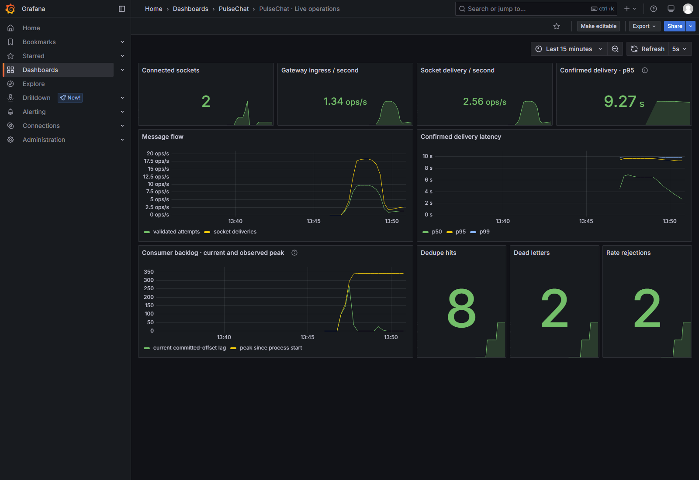

# PulseChat

A distributed real-time chat project built in independently verified phases with Node.js, TypeScript, Kafka, Redis, and MongoDB.

**Current scope: backend Phases 1–2.** Registration/login, 1:1 chat creation, authenticated WebSockets, Kafka processing, idempotent sequence assignment, MongoDB persistence, and cross-gateway delivery are implemented and verified. Reliability clients/receipts/presence, application dashboards, chaos/load proof, and the independent React frontend follow in later phases. The repository does not yet provide a chat UI.

## Start locally

Prerequisites: Docker Desktop with Linux containers and Docker Compose v2. For local backend development, Node.js 20+ and npm are also required. The stack includes three gateway instances, two processor instances, and six infrastructure services. Allow approximately 4 GB of memory for Docker as a starting point; this is a recommendation, not a measured requirement.

From the repository root:

```sh
docker compose --parallel 1 up --build -d --wait --wait-timeout 600
docker compose run --rm smoke
```

`docker compose up --build` also works in the foreground. Every backend replica creates the three required topics safely on startup and verifies their configuration. Kafka uses KRaft with six partitions per topic, explicit topic creation, and a single local broker. Redis uses AOF persistence. MongoDB has unique message ID and `(chatId, seq)` indexes. Its WiredTiger cache is capped at 0.25 GiB for this local stack; Kafka's broker heap is capped at 512 MiB. Kafka and MongoDB container probes check TCP listeners; every backend `/readyz` and the smoke test verify actual Kafka metadata and MongoDB commands. This keeps container probes inexpensive on small development machines.

Only one gateway image and one processor image are built; replicas reuse those images. On memory-constrained machines, use `docker compose --parallel 1 up --build -d --wait --wait-timeout 600` to serialize image preparation.

| Endpoint | Purpose |
| --- | --- |
| http://localhost:8080/healthz | Nginx liveness |
| http://localhost:8080/readyz | Proxied gateway readiness |
| http://localhost:8080/api/healthz | Gateway liveness |
| http://localhost:8080/api/readyz | Gateway readiness with dependency results |
| http://localhost:9090 | Prometheus |
| http://localhost:3000 | Grafana; local defaults `admin` / `pulsechat-local` |

Grafana's Prometheus datasource is provisioned automatically. Backend `/metrics` endpoints export process metrics plus connections, message flow, consumer lag, delivery-ACK latency, dedupe, DLQ, and rate-rejection metrics. Open [the live operations dashboard](http://localhost:3000/d/pulsechat-overview) after signing in. See [metric definitions](docs/OBSERVABILITY.md) and [Phase 4 verification](docs/phase-4-verification.md). Nginx uses `least_conn` and Docker DNS resolution to track recreated gateways. The `/ws` route authenticates JWTs and supports messaging, receipts, sync, and presence.

All published ports bind to loopback. The local database and Kafka listeners are unauthenticated. These Compose defaults target a development machine. Copy `.env.example` to `.env` to override the local JWT secret or Grafana password. After Grafana's first start, changing the environment variable alone does not reset its persisted admin password.

## Backend checks

```sh
cd backend
npm ci
npm run lint
npm run format:check
npm run typecheck
npm test
npm run build
```

The 60 unit tests cover configuration, protocol validation, JWT authentication, bounded HTTP input, topic bootstrap, readiness, HTTP dispatch, gap recovery, and reconnect/resend behavior. The container smoke test verifies all five replicas, all three Kafka topics and their leaders, MongoDB indexes, Redis connectivity, Nginx proxying, Prometheus scrapes, and Grafana's provisioned datasource. It returns a failing exit code if any assertion fails and does not repair missing topics or indexes.

Run the real backend integration suite after starting the stack:

```sh
docker compose --parallel 1 run --build --rm integration
```

The Phase 2 gate passed all four integration cases: authorization boundaries, 1,000 messages across different gateways in order with matching MongoDB sequences and zero duplicate wire delivery, five duplicate sends producing one stored message, and concurrent counter reseeding. The expanded Phase 3 integration suite passes all 10 cases, including 125 offline messages recovered in order, persisted delivered/read cursors, duplicate sessions across gateways, poison-record DLQ continuation, rate rejection, malformed JSON, binary frames, and oversized payloads. A separate host-run crash check observed presence expiry in about 30 seconds. Run it from `backend/` with `npm run test:presence`; it kills and restores only PulseChat gateway-3. See [Phase 3 verification](docs/phase-3-verification.md). This is correctness evidence, not a load benchmark. See [the protocol](docs/PROTOCOL.md), [the design](docs/DESIGN.md), and [Phase 2 verification](docs/phase-2-verification.md).

To run a backend process on the host, start the dependencies with `docker compose up -d kafka redis mongo`, set the environment variables listed in `backend/.env.example`, and run `npm run dev:gateway` or `npm run dev:processor`. Use a different `PORT` for each process. Host clients use Kafka at `localhost:19092`, Redis at `localhost:16379`, and MongoDB at `localhost:27018`. Containers use their service names and native ports; these host database ports avoid collisions with common local database installations.

Readiness probes actually contact Kafka, Redis, and MongoDB; `/healthz` stays live during dependency outages. Backend processes handle SIGINT/SIGTERM with a bounded shutdown and dependency cleanup. Docker restarts failed services. A single Kafka broker, Redis instance, and MongoDB instance are local development limits, not an infrastructure high-availability claim.

## Layout

```text
docker-compose.yml
backend/
  packages/{gateway,processor,shared}/
  tests/{unit,smoke.mjs}
infra/
  nginx/
  prometheus/
  grafana/provisioning/
docs/
```

The backend is its own npm workspace root. The frontend will be a separate app with its own dependencies in Phase 6. Its HTTP/WebSocket contract is documented in `docs/PROTOCOL.md`.

## Development phases

1. Infrastructure and backend skeleton, with a live Compose smoke gate.
2. Auth and core 1:1 messaging, with ordered and duplicate-send integration tests.
3. Receipts, recovery, presence, shutdown, rate limiting, and DLQ handling.
4. Application metrics, Grafana dashboard, and a real dashboard screenshot.
5. Chaos assertions, measured k6 benchmarks, CI, and design documentation.
6. Independent React/Vite frontend and reconnecting browser SDK.

Each phase must pass its completion checks and receive its own commit before the next begins. No benchmark results, chaos outcomes, or remote CI status are claimed until measured.

Stop the stack with `docker compose down`. Named volumes preserve data across restarts.

## Operations dashboard

Actual Grafana data captured after message traffic and intentional failure-path probes:


