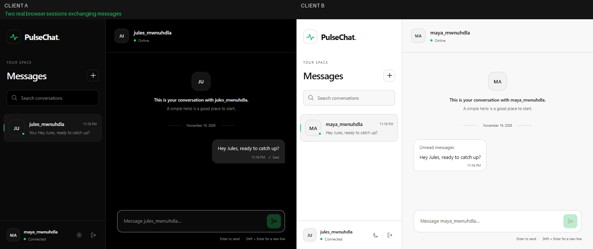
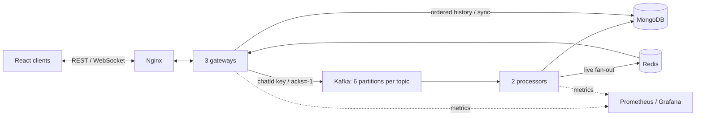

# PulseChat

[](https://github.com/ShlokMaharwal/PulseChat/actions/workflows/ci.yml)



[Reproduce the recorded demo](docs/verification/task-6.md) · [Actual recording proof](docs/verification/demo-proof.json)

Real-time direct and small-group chat with three WebSocket gateways, two Kafka processors, Redis routing, and MongoDB persistence. An independent React frontend provides live typing indicators, presence, unread counts, receipts, offline queuing, and light/dark themes.



## Quick start

Use Docker Desktop with Linux containers, Compose v2, and Node.js 22.13+ for setup and host tooling. Run from the repository root:

```sh
node tools/init-env.mjs
docker compose --parallel 1 up --build -d --wait --wait-timeout 600
docker compose run --rm --no-deps smoke
```

Open [PulseChat](http://localhost:8080), [Prometheus](http://localhost:9090), or the [Grafana dashboard](http://localhost:3000/d/pulsechat-overview). The initializer generates JWT and optional database secrets in ignored `.env`. Grafana's local credentials default to `admin` / `pulsechat-local`; an existing volume retains its previous password. If port 8080 is occupied, set `PULSECHAT_PORT=8081`.

`docker compose stop` stops services; `docker compose up -d --wait` resumes them. Named volumes retain accounts, history, and receipts. See [development and test commands](docs/TESTING.md).

## Demo

1. Open the app in two separate browser profiles and register different accounts.
2. Choose **New conversation**, search for the second username, and exchange messages. Check sent, delivered, and read states.
3. Disconnect one browser, send from both sessions, then reconnect. Queued sends retain their IDs and history recovers in sequence.
4. Toggle the theme and reload. The saved theme persists.
5. Choose **New conversation → New group**, name the group, select at least two people, and create it. Groups support up to 20 members including you. Typing appears in the conversation header and sidebar, clears on send/idle, and expires after a lost connection. Password fields have a show/hide control; chat and form text use a larger system-font scale.


The interface retains true black and neutral gray surfaces with emerald accents. [Light theme](docs/img/chat-light.png) · [Mobile](docs/img/chat-mobile.png) · [Recorded browser verification](docs/verification/phase-6-browser.json).

## Guarantees

- Acceptance ACK follows Kafka `acks=-1`; the later `sent` ACK follows persistence.
- Stable sender-scoped IDs, unique MongoDB indexes, and idempotent Redis Lua sequences provide effectively-once storage under the tested retry model.
- Chat-keyed Kafka ordering, serial work within each partition, manual offsets, and ordered paginated sync preserve per-chat recovery.
- Durable cumulative receipt cursors, bounded queues/frames, membership checks, dependency-aware retries, and visible terminal DLQ failures.

Details: [protocol](docs/PROTOCOL.md), [design and failure boundaries](docs/DESIGN.md), [metrics](docs/OBSERVABILITY.md), and [performance changes](docs/PERFORMANCE.md).

## Proof

| Check | Recorded result | Evidence |
| --- | --- | --- |
| Current source checks | 86 backend and 17 frontend unit tests; lint, format, types, builds passed | [Groups and typing verification](docs/verification/groups-and-typing.md) |
| Current feature checks | Two focused live integration cases and a three-user real browser flow passed; password visibility and mobile layout checked | [Groups and typing verification](docs/verification/groups-and-typing.md) |
| Integration / smoke | Thirteen integration cases, including 1,000 ordered messages; eleven smoke checks | [Reliability verification](docs/verification/task-5.md) |
| Crash / outage recovery | Six default-stack scenarios, 725 sends, zero loss, logical/wire duplicates, or order errors | [Actual summaries](docs/verification/task-5-chaos/) |
| Kafka HA broker failure | 120/120 stored and delivered after active-leader SIGKILL; zero loss, duplicates, or order errors | [Three-broker CI proof](docs/verification/task-5-chaos/kafka-ha-ci.json) |
| Browser recovery | Five real browser tests passed, including offline recovery, gateway SIGKILL, and token renewal/logout | [Browser verification](docs/verification/task-6.md) |
| Configured 200-user load | Steady peer delivery 4.87 → 11.50 messages/s; all 1,367 optimized sends persisted and reached peers | [Measured comparison and caveats](docs/benchmarks.md) |
| Overload / acceptance | All 2,233 Kafka-accepted sends persisted in the 500-target overload run | [Classification and historical 17-attempt investigation](docs/verification/task-2.md) |
| Final configured 200-user check | All 1,384 issued messages ACKed, persisted, and peer delivered after verified drain | [Final measurements and caveats](docs/benchmarks.md#final-verification-run) |

The general integration, browser recovery, chaos, and load rows record the earlier verified revision. Current group and typing checks, including the initial local environment failures and successful focused reruns, are recorded [separately](docs/verification/groups-and-typing.md).

Latency remains high. The 500-user run overloaded the system, and independent server connection measurements dipped even at the configured 200-user load. No production capacity or low-latency guarantee is claimed. [Raw evidence and exact percentiles](docs/benchmarks.md).

## Known limitations

The default stack has one Kafka broker, one MongoDB instance, and one Redis instance. Redis Pub/Sub is best effort; sync is required to recover missed live events. A terminal DLQ failure after sequence allocation can leave a sequence gap. The optional [three-broker Kafka profile](docs/verification/task-5.md) has separate verification; the default stack's process-failure tests do not establish infrastructure high availability. Group membership is set at creation; editing membership is not implemented. Typing is ephemeral and best effort.

[Testing and reproduction](docs/TESTING.md) · [What changed and remaining limits](docs/CHANGES.md) · [Evidence-backed resume bullets](docs/resume-bullets.md)
