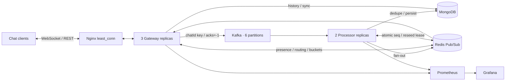

# PulseChat

[](https://github.com/ShlokMaharwal/PulseChat/actions/workflows/ci.yml)

A distributed real-time chat system built with TypeScript, WebSockets, Kafka, Redis, and MongoDB. The backend is replicated across three gateways and two processors. Correctness, replay, failure recovery, and measured limits are documented alongside the implementation.

Backend Phases 1–4 are verified. Phase 5 adds passing local chaos proofs, real load measurements, and the CI workflow; its remote run is checked before frontend work begins. The independent React frontend is Phase 6. This revision provides authenticated chat APIs and a Node recovery client, without a browser chat UI.



## Quick start

Use Docker Desktop with Linux containers and Docker Compose v2. Allow around 4 GiB of Docker memory as a starting point; the recorded tests used 2.77 GiB and encountered limits. Node.js 20+ and npm are needed for host-run checks.

```sh
docker compose --parallel 1 up --build -d --wait --wait-timeout 600
docker compose run --rm --no-deps smoke
```

`docker compose up --build` also starts the stack in the foreground. Backend replicas create/verify the required topics and indexes on startup. Kafka uses KRaft and one broker. Redis has AOF persistence. MongoDB's WiredTiger cache is capped at 0.25 GiB, and Kafka's heap at 512 MiB for local development. Lightweight container TCP probes are supplemented by actual dependency commands in backend readiness and smoke checks.

| URL | Purpose |
| --- | --- |
| `http://localhost:8080/api/auth/register` | Registration endpoint |
| `http://localhost:8080/ws` | Authenticated WebSocket upgrade |
| `http://localhost:8080/healthz` | Nginx liveness |
| `http://localhost:8080/readyz` | Proxied gateway readiness |
| `http://localhost:9090` | Prometheus |
| `http://localhost:3000/d/pulsechat-overview` | Provisioned Grafana dashboard |

Grafana local defaults are `admin` / `pulsechat-local`. Copy `.env.example` to `.env` to change the development JWT secret or Grafana password. Changing the password environment variable does not reset Grafana's already-persisted admin account. All published ports bind to loopback; the unauthenticated local Kafka, MongoDB, and Redis listeners and the single-node data services are development defaults.

For backend-only containers, omit the reverse proxy and monitoring UI:

```sh
docker compose --parallel 1 up --build -d --wait kafka redis mongo gateway-1 gateway-2 gateway-3 processor-1 processor-2
```

The integration runner reaches those gateways directly on the Compose network. For host development, start `kafka redis mongo`, set a JWT secret of at least 32 characters, then run `npm ci` and `npm run dev:gateway` or `npm run dev:processor` in `backend/`. Host defaults use Kafka `19092`, Redis `16379`, and MongoDB `27018`. The gateway's direct REST paths omit `/api`.

## Behavior and guarantees

- Bcrypt password hashing and expiring HS256 JWTs; membership checks for sends, history, receipts, and presence.
- Kafka acceptance ACK followed by a persisted `sent` ACK; stable sender-scoped UUIDs and unique indexes dedupe retries.
- Atomic Redis sequence assignment with idempotent message mappings and a lease-guarded MongoDB reseed when counters disappear.
- Ordered, paginated sync and periodic tail recovery; reconnect with exponential backoff/jitter and reuse of unacked IDs.
- Persisted cumulative delivered/read cursors, unread counts, TTL presence, and concurrent sessions across gateways.
- Arrival-time per-user token buckets, bounded frame size, bounded queues/output, and graceful service shutdown.
- Manual Kafka offsets, bounded record retries, durable DLQ envelopes, structured correlation logs, and application telemetry.

Storage is effectively once under the tested crash/retry model. Pub/Sub is best effort, and sync is required for recovery. A terminal DLQ record is a visible delivery failure. This local single-broker/single-database stack does not provide infrastructure high availability. See [the protocol](docs/PROTOCOL.md) and [design and failure boundaries](docs/DESIGN.md).

## Tests and proof

```sh
cd backend
npm ci
npm run lint
npm run format:check
npm run typecheck
npm test
npm run build
cd ..
docker compose --parallel 1 build integration
docker compose --profile test run --rm --no-deps integration
cd backend
npm run test:presence
npm run test:chaos
npm run test:load -- 200
npm run test:load -- 2000
```

The 60 unit tests cover configuration, protocol/auth boundaries, bounded HTTP input, readiness, and recovery-client behavior. The 10 integration cases verify 1,000 cross-gateway messages in order with matching MongoDB sequences and zero duplicate wire deliveries, retry dedupe, authorization, 125 offline messages, receipts, duplicate sessions, DLQ continuation, and invalid/limited frames.

The four chaos scripts are independently runnable with `npm exec -- tsx chaos/gateway.ts` (or `processor.ts`, `redis.ts`, `kafka.ts`) from `backend/`. They restore interrupted containers and print PASS/FAIL counts. The recorded runs covered 485 logical sends with zero lost messages, duplicates, or order violations. The processor kill interrupted a partial batch with 79 messages remaining. [Raw chaos summaries](docs/chaos-results/) are committed.

The actual load result is constrained: **200 observed baseline sockets; 533 observed peak during a failed 2,000-socket attempt**. The baseline confirmed 3.64 messages/second with p50/p95/p99 of 3,820.50/11,082.25/17,758.11 ms. The stress attempt confirmed 6.80 messages/second with substantial errors and 17 issued sends absent from MongoDB at the later observation. It did not meet the requested connection target. Both runs reused 32 users across 16 chats. See [all measurements, raw data, and limitations](docs/benchmarks.md).

GitHub Actions runs backend lint, formatting, types, unit tests, build, real Compose integration/smoke, and all four chaos scenarios. A separate frontend job activates when Phase 6 adds its lockfile. No frontend result is claimed before that application exists.

## Operations dashboard

The actual dashboard after message traffic and intentional failure-path probes:


All ten panels contain real data. Current and historical peak lag are distinguished, and delivery-ACK timing includes the return path. See [metric definitions](docs/OBSERVABILITY.md), [captured query values](docs/phase-4-metrics.json), and [Phase 4 verification](docs/phase-4-verification.md).

## Repository

```text
backend/
  packages/gateway/     WebSocket and authenticated HTTP service
  packages/processor/   Ordered Kafka consumers and persistence
  packages/shared/      Schemas, dependencies, sequencing, routing, telemetry
  tests/                Unit, integration, recovery client, host probes
  chaos/                Asserted failure scenarios
  loadtest/             k6 adapter, runner, and persistence analysis
infra/
  nginx/ prometheus/ grafana/
docs/                   Protocol, design, proof, measurements, screenshot
.github/workflows/      Independent application CI jobs
```

Verification evidence: [Phase 1](docs/phase-1-verification.md), [Phase 2](docs/phase-2-verification.md), [Phase 3](docs/phase-3-verification.md), [Phase 4](docs/phase-4-verification.md), and [backend proof](docs/phase-5-verification.md). [Resume bullets](docs/resume-bullets.md) use recorded numbers only.
